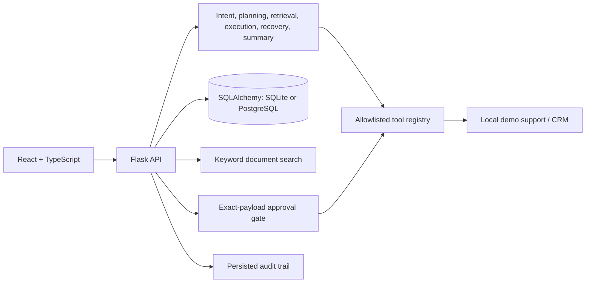

# FlowPilot AI

Plan, execute, validate and monitor AI-powered business workflows. This repository is a **separate local project** from NewsLens AI and SentinelAI. The current build provides a runnable deterministic demonstration with real persisted backend data and human approval gates. It does not claim live AI-provider execution or production deployment.

## Features

- Flask REST API and React/TypeScript dashboard.
- SQLite persistence locally; PostgreSQL in Docker Compose.
- Support assistant, document extraction, and synthetic lead processing templates.
- Approval pause and resume tied to the exact proposed payload; replay and altered-payload approvals are rejected.
- Local mock support/CRM action results, execution records, and audit events.
- TXT/Markdown upload, keyword retrieval, and source references.
- A LangGraph template path, typed deterministic agent modules, fixed tool registry, workflow plan validation, health and dashboard endpoints.
- Offline pytest checks and deterministic evaluation fixtures.

## Architecture



## Agent responsibilities

Six focused modules separate intent extraction, planning, knowledge retrieval, tool execution, safe failure classification, and final reporting. They are deterministic in this build. No LLM calls or hidden reasoning traces are presented as having run.

## Run locally

Prerequisites: Python 3.11+, Node.js 20+, npm.

```powershell
cd backend
python -m venv .venv
.venv\Scripts\Activate.ps1
pip install -r requirements.txt
python run.py
```

In another terminal:

```powershell
cd frontend
npm install
npm run dev
```

Open http://localhost:5173. The API defaults to http://localhost:5000/api/v1. SQLite creates `backend/flowpilot.db` on first start.

## Docker

Copy `.env.example` to `.env`, then run `docker compose up --build`. PostgreSQL data is kept in a named volume. Redis is not used by this implementation. Do not expose the local demo as a production service.

## Templates and approvals

Use **Workflows** to run the support or lead demo. These complete deterministic preparation and stop at a pending approval. In **Approval center**, inspect the full proposed payload, then approve or reject. The demo connector reports confirmation only after approval. The document extraction template is available through the API:

```powershell
Invoke-RestMethod -Method Post -Uri http://localhost:5000/api/v1/templates/document/run -ContentType 'application/json' -Body '{"text":"vendor: Example Co`namount: 12","fields":["vendor","amount","date"]}'
```

Planning is deterministic and explicitly separate from execution. `POST /api/v1/workflows/plan` returns a proposal; `POST /api/v1/workflows` persists a registry-validated plan. See [docs/api.md](docs/api.md).

## Knowledge base

Upload UTF-8 `.txt` or `.md` files in the dashboard. Search returns only actual passages and stored document IDs. Ranking is a simple lexical overlap fallback; vector embeddings and PDF parsing are not active.

## Configuration

See [.env.example](.env.example). Local template runs require no paid service or API key. `GEMINI_API_KEY` and `GEMINI_MODEL` are placeholders for a future provider adapter; no Gemini request is made. Frontend may use `VITE_API_URL` to choose the API base.

## Tests and evaluations

```powershell
cd backend
python -m pytest -q
cd ..
python evals/run_evaluations.py
```

Evaluation metrics are calculated over three explicit deterministic fixtures; no model judge or quality benchmark is claimed.

## Limitations and deployment path

This demonstration has no authentication/role system, no durable asynchronous worker, no database migration history, and no LangGraph checkpoint restore (approval resumes from persisted application records). API-level approvals in local mode are for demonstration and not a production identity boundary. Only mock connectors are executable. RAG supports keyword search over TXT/Markdown. Docker Compose is a local setup, not an AWS deployment. For AWS, add managed PostgreSQL, secret storage, an authenticated worker queue, TLS/reverse proxy, restricted egress, migrations, observability, and deploy through ECS/Fargate or an equivalent managed runtime. See [security notes](docs/security.md) and [integration status](docs/integrations.md).

## Project structure

`backend/app/{agents,api,graph,services,tools}` contains the service implementation (routes currently live in the Flask factory); `backend/tests` contains deterministic API tests; `frontend/src` contains the React dashboard; `evals` contains fixtures and metric runner; `docs` describes architecture, API, security, and connector status.

Screenshots: not included; none have been captured from a running application.
