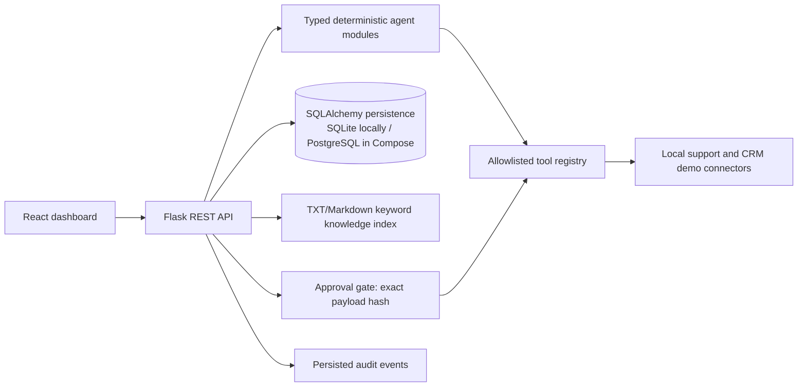

# Architecture

Workflow template preparation runs through an explicit LangGraph validation-to-execution graph. Workflow state is persisted before approval pauses; the approval endpoint resumes the persisted application workflow (it does not restore a LangGraph checkpoint). Approval verifies the exact SHA-256 payload digest, is single use, and records connector confirmation and audit events. This is a local demonstration; authentication and process-backed background queues are not implemented.
